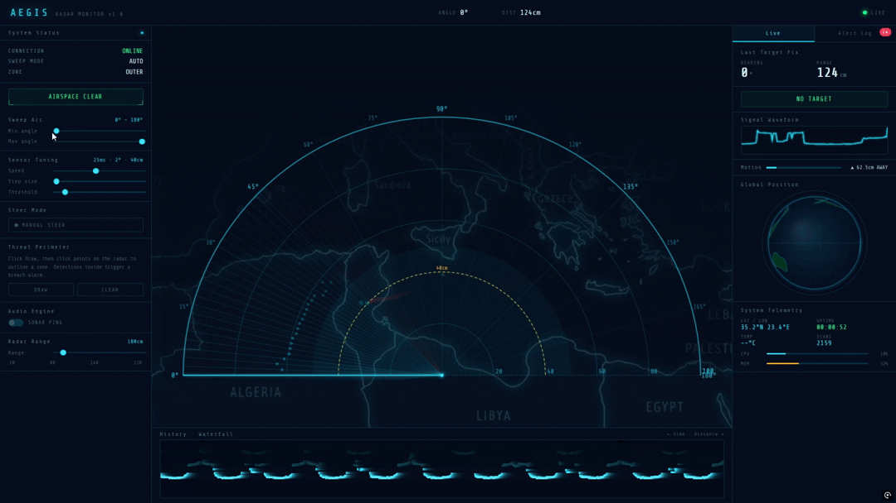
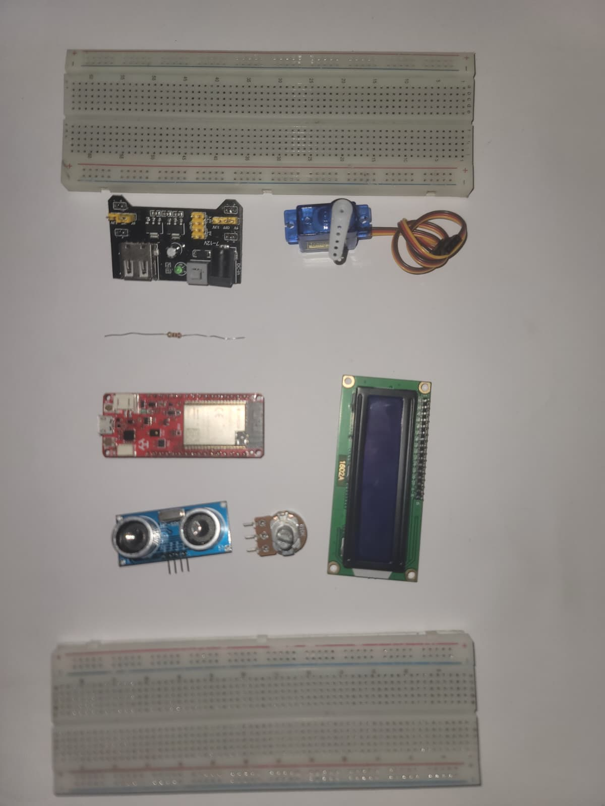

# AEGIS — Networked Rotating Ultrasonic Radar System




A radar system on the **Deneyap Kart 1A (ESP32-S3)**. A servo sweeps an
HC-SR04 ultrasonic sensor across a 180° arc; the board streams range
telemetry over WebSocket and serves a full dashboard from its own flash —
no external server, no app.

---

## How it works

Sweep and sensing run in a non-blocking loop: each step is gated by a
millisecond timer, not `delay()`, so the WebSocket and HTTP stacks stay
responsive between steps.

```
[Servo position] → [HC-SR04 pulse] → [distance measurement]
       ↓                                        ↓
  [LCD update]                     [WebSocket broadcast]
                                            ↓
                                   [Browser radar canvas]
```

Inbound commands from the dashboard arrive as JSON over WebSocket port 81
and apply to the live sweep parameters immediately — no reflash.

**Offline behavior:** if Wi-Fi association fails after 30 attempts
(~12 seconds), the LCD shows `OFFLINE MODE` and the sweep loop keeps
running locally. The dashboard is unreachable in that state, but ranging,
detection, and the LCD readout are unaffected — the radar doesn't depend on
the network being up to function.

---

## Features

**Hardware**

- Continuous 0–180° servo sweep, configurable range/speed/step
- HC-SR04 ranging to 300cm
- 1602A LCD showing live angle, distance, detection state — no `clear()`
  in the loop, so no flicker
- Falls back to local-only operation if Wi-Fi is unavailable

**Dashboard** (served at `http://<device-ip>`)

- Radar scope with sweep beam, phosphor trail, range rings
- On-canvas adjustable detection threshold
- Manual steer — click/drag on the canvas to aim the servo directly
- Threat perimeter — draw a polygon; detections inside it trigger a breach
  alarm
- Waterfall history strip, signal waveform panel, motion intensity meter
- Alert log with INNER/OUTER zone classification
- Sonar ping tones scaled by target distance (Web Audio API)
- System telemetry: CPU%, memory%, uptime, chip temperature
- Auto-reconnecting WebSocket — survives reload and short network drops

**Firmware controls** (all runtime-adjustable, no reflash)

| Command | Effect |
|---|---|
| `SET_SWEEP_MIN` | Left boundary of sweep arc (0–180°) |
| `SET_SWEEP_MAX` | Right boundary of sweep arc (0–180°) |
| `SET_STEP_DEG` | Angular resolution per step (1–10°) |
| `SET_STEP_DELAY` | Milliseconds between steps (5–200ms) |
| `SET_THRESHOLD` | Detection distance in cm (1–300cm) |
| `MANUAL_STEER` | Point servo to a specific angle |
| `AUTO_RESUME` | Return to automatic sweep |

▶ [Demo video](https://youtu.be/lgbAfCLylXU)

---

## WebSocket protocol

One frame broadcast per sweep step on port 81.

**Outbound (board → browser):**
```json
{ "a": 90, "d": 34.2, "det": true }
```
- `a` — servo angle (0–180°)
- `d` — distance in cm, or `-1` if out of range
- `det` — `true` if within detection threshold

**Inbound (browser → board):** see the firmware controls table above.

---

## Hardware requirements

| Component | Qty | Notes |
|---|---|---|
| Deneyap Kart 1A | 1 | ESP32-S3 based; other ESP32 boards need pin remapping |
| HC-SR04 | 1 | 5V supply required |
| SG90 servo | 1 | 5V supply required; never power from board 3.3V |
| 1602A LCD (HD44780-compatible) | 1 | 16-pin, 4-bit parallel |
| MB102 breadboard power module | 1 | Supplies 5V to servo, sensor, LCD |
| 9V DC wall adapter | 1 | Centre-positive, ≥1A. Not a PP3 battery |
| 10kΩ potentiometer | 1 | LCD contrast |
| 220Ω resistor | 1 | LCD backlight current limiting |

## Wiring

Full pin map: [WIRING.md](WIRING.md).

| Deneyap pin | Connected to |
|---|---|
| D0 | SG90 PWM signal |
| D1 | HC-SR04 TRIG |
| D11 | HC-SR04 ECHO |
| D4 | LCD Enable |
| D5–D7 | LCD D4–D6 |
| D10 | LCD RS |
| D12 | LCD D7 |
| GND | MB102 GND rail (mandatory common ground) |

> The MB102 GND rail **must** be wired to the Deneyap Kart GND pin — without
> a shared ground reference, signal levels are undefined.



---

## Software setup

### 1. Prerequisites

- [Arduino IDE 2.x](https://www.arduino.cc/en/software)
- Deneyap Kart board package — add under *File → Preferences → Additional
  boards manager URLs*:
  ```
  https://raw.githubusercontent.com/deneyapkart/deneyapkart-arduino-core/master/package_deneyapkart_index.json
  ```
  then install **Deneyap Kart** via *Tools → Board → Boards Manager*.

### 2. Libraries

Install via *Tools → Manage Libraries*:

| Library | Author |
|---|---|
| WebSockets | Markus Sattler |
| ESP32Servo | Kevin Harrington |
| ArduinoJson | Benoit Blanchon |

`LiquidCrystal` and `WiFi` ship with the board package.

### 3. Wi-Fi credentials

```bash
cp firmware/aegis-deneyap/secrets.h.example firmware/aegis-deneyap/secrets.h
```

Edit `secrets.h`:
```cpp
#define WIFI_SSID     "your_network_name"
#define WIFI_PASSWORD "your_password"
```

`secrets.h` is gitignored and never committed.

### 4. Flash

1. Open `firmware/aegis-deneyap/aegis-deneyap.ino`
2. `Tools → Board → Deneyap Kart 1A`
3. Select the correct COM port
4. Upload

On boot, the LCD shows `AEGIS v1.0`, then `Connecting WiFi`, then the
board's IP address for ~3 seconds before the radar loop starts.

### 5. Open the dashboard

On the same Wi-Fi network:
```
http://<ip from LCD or serial monitor 115200>
```

Served directly from flash — no internet needed after first font load (or
remove the Google Fonts import in `dashboard.h` for fully offline use).

---

## Project structure

```
aegis-embedded-system/
├── assets/
├── firmware/
│   └── aegis-deneyap/
│       ├── aegis-deneyap.ino   # Main firmware — radar loop, Wi-Fi, WebSocket
│       ├── dashboard.h         # Self-contained dashboard, stored in flash
│       ├── secrets.h           # Not committed
│       └── secrets.h.example
├── hardware/
│   ├── aegis.kicad_sch
│   ├── aegis.kicad_pcb
│   ├── aegis.kicad_pro
│   └── HC-SR04/
├── .gitignore
├── README.md
└── WIRING.md
```

---

## License

MIT — see [LICENSE](LICENSE).

## Acknowledgements

- [WebSockets](https://github.com/Links2004/arduinoWebSockets) — Markus Sattler
- [ESP32Servo](https://github.com/madhephaestus/ESP32Servo) — Kevin Harrington
- [ArduinoJson](https://arduinojson.org) — Benoit Blanchon
- Deneyap Kart board support — [Deneyap](https://deneyapkart.org)
- [HC-SR04 KiCad model](https://www.snapeda.com/parts/HC-SR04/SparkFun/view-part/) — SparkFun
